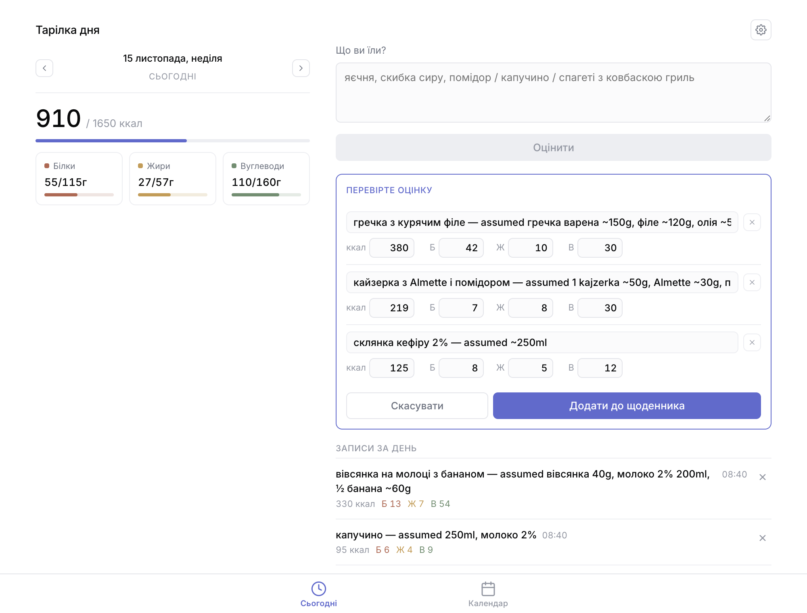
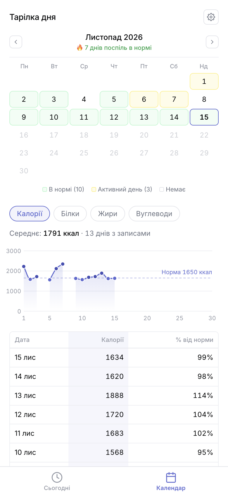
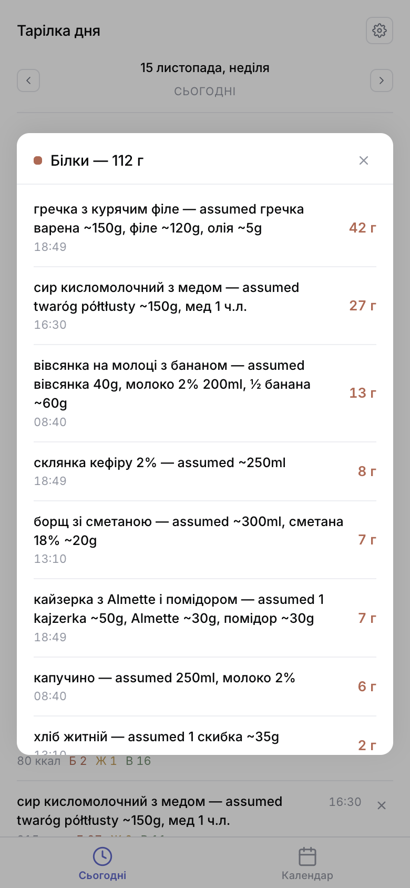

# Тарілка дня · Plate of the Day

**An AI food diary.** Describe what you ate in plain words, and Claude turns it into calories and macros. It shows the portions it assumed, so you can check the math. The app keeps your daily history, streaks and trends.

**Try it:** [annvaskovska.github.io/mycalories](https://annvaskovska.github.io/mycalories/). Paste your own [Anthropic API key](https://console.anthropic.com/); it stays in your browser.



<sub>Typed: <i>«гречка з курячим філе, кайзерка з Almette і помідором, склянка кефіру»</i> (buckwheat with chicken, a kaiser roll with Almette and tomato, a glass of kefir). The estimate splits it into three items and lists the portion assumed for each ingredient. Every field stays editable until the meal goes into the diary. The interface is in Ukrainian; screenshots use demo data.</sub>

## Features

- **Log meals in plain language.** Write the way you would text a friend, in any language (the app is tuned for Ukrainian). Claude splits the text into separate items, keeps dishes eaten together as one, and estimates kcal, protein, fat and carbs for each.
- **See how every number was calculated.** Composite dishes state the assumed amount of each ingredient, e.g. *"assumed ½ kajzerka ~25g, Almette ~20g, помідор 2 thin slices ~10g"*. Before anything is saved you review the estimate: rename items, adjust any number, or drop what you didn't eat.
- **Estimates calibrated for real life.** Moderate home portions rather than restaurant ones, Polish-market products and package sizes, known label values for named brands. The app never asks follow-up questions; when the amount is unclear, it takes the smaller plausible one.
- **Daily dashboard.** Calories against your goal, plus protein, fat and carbs progress, with a "+N over" marker when you exceed one. Tap a macro to see which foods it came from. Step back to earlier days to review or fill them in.
- **Calendar with streaks.** Each day is colored by how it went: green within 115% of the calorie goal, yellow above it, blank when nothing was logged. The header counts your current run of on-target days, and tapping a day opens it.
- **Monthly trends.** Switch between calories, protein, fat and carbs to see the month's line against your target, the average across logged days, and a per-day table with the percentage of the goal.
- **Private by design.** No backend, no account. Your diary, goals and API key stay in your browser's `localStorage`. The only data that leaves it is the meal text you type, sent straight to the Anthropic API.

<table>
  <tr>
    <td align="center" width="50%"></td>
    <td align="center" width="50%"></td>
  </tr>
  <tr>
    <td align="center"><b>Calendar and trends</b><br>Streak, day statuses and the month's calories against the target</td>
    <td align="center"><b>Macro breakdown</b><br>Tap a macro to see which foods made up today's total</td>
  </tr>
</table>

## How the estimate works

```text
 "гречка з курячим філе, склянка кефіру"
                  │
                  ▼
 Claude Sonnet 4.6 + calibration prompt          src/components/FoodInput.jsx
                  │  returns JSON: [{ name, kcal, protein, fat, carbs }]
                  ▼
 Review card: edit, remove, confirm              src/components/StagingList.jsx
                  │
                  ▼
 localStorage  entries:YYYY-MM-DD  ──►  Today · Calendar · Trends
```

The system prompt asks Claude to:

1. Split the text into food items, keeping dishes eaten together as one item.
2. Estimate kcal, protein, fat and carbs for each, assuming:
   - moderate home portions when no quantity is given;
   - Polish-market products and package sizes (a kajzerka ≈ 40–50 g, a cheese slice ≈ 15–20 g);
   - known packaged-product values when a brand is named.
3. Never ask a clarifying question: an ambiguous amount resolves to the smaller plausible value.
4. For composite dishes, put the assumed quantity of each ingredient into the item's name, so the reasoning stays visible in the diary.
5. Reply with a bare JSON array, which the app parses into the review card.

## Tech stack

- **React 19** and **Vite 8**: no router, no state library, no UI kit.
- **Hand-drawn SVG chart.** The trend line uses monotone cubic (Fritsch–Carlson) interpolation, so it stays smooth without overshooting the data.
- **Anthropic Messages API** (`claude-sonnet-4-6`), called directly from the browser.
- **Oxlint** for linting.

## Run it locally

You need Node.js 20.19+ (or 22.12+) and an [Anthropic API key](https://console.anthropic.com/).

```sh
git clone https://github.com/annvaskovska/mycalories.git
cd mycalories
npm install
npm run dev
```

Open http://localhost:5173, paste your API key, and describe your first meal. Daily goals default to 1650 kcal, 115 g protein, 57 g fat and 160 g carbs; change them under ⚙.

| Command           | What it does                         |
| ----------------- | ------------------------------------ |
| `npm run dev`     | Start the dev server with hot reload |
| `npm run build`   | Build for production into `dist/`    |
| `npm run preview` | Serve the production build locally  |
| `npm run lint`    | Lint with Oxlint                     |

## Your data and API key

- Everything lives in the `localStorage` of the browser you use: one key per day (`entries:YYYY-MM-DD`), plus your goals and API key. Clearing the site's data erases them.
- Requests go from the browser straight to `api.anthropic.com` with the `anthropic-dangerous-direct-browser-access` header. That suits a personal tool you run with your own key. Don't host it publicly with a key built in, because any visitor could read it.

## Project structure

```text
src/
├── App.jsx                 state, tabs, persistence in localStorage
├── index.css               design tokens and responsive layout
└── components/
    ├── FoodInput.jsx       meal input, calibration prompt, Claude API call
    ├── StagingList.jsx     review and edit the estimate before saving
    ├── DailyProgress.jsx   calorie and macro progress, per-macro breakdown
    ├── EntryLog.jsx        the day's entries
    ├── DateNav.jsx         previous / next day
    ├── CalendarView.jsx    month grid, day statuses, streak
    ├── MacroHistory.jsx    trend chart and per-day table
    ├── Settings.jsx        daily goals and API key
    ├── ApiKeyPrompt.jsx    first-run key entry
    └── TabBar.jsx          bottom navigation
```
